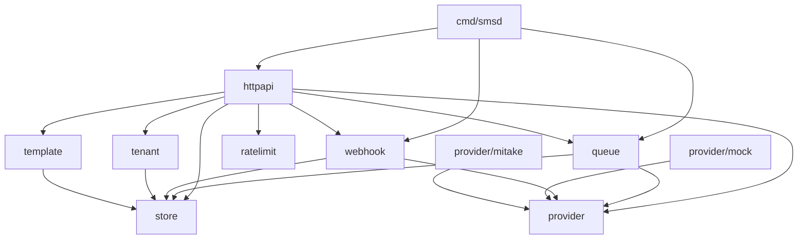
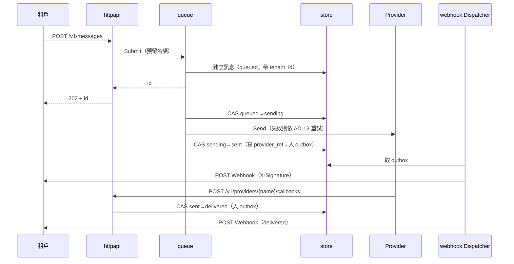
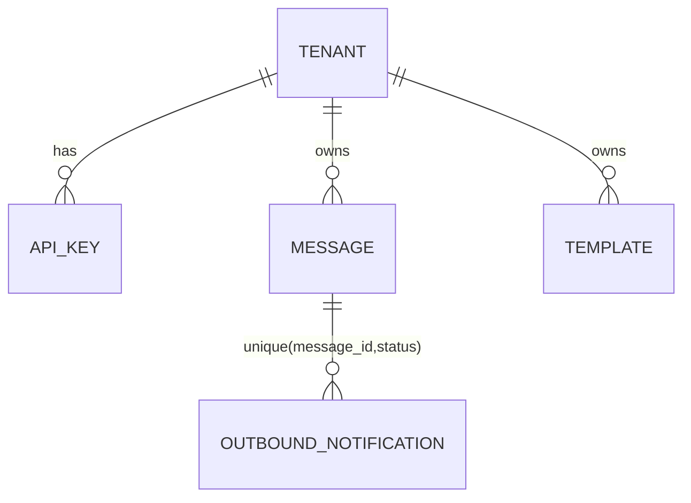

# Architecture Spine — sms-platform

> **前提 [ASSUMPTION]：採自建。** PRD §8 Q2（自建 vs 現成方案）未結案。結論若為採用現成方案，本 spine 作廢並重審。

## Design Paradigm

**Ports & Adapters（六角形）**。核心是訊息狀態機；對外的埠（port）是 `provider.Provider`、`queue.Queue`、`store` 的 repository 介面。HTTP 與設定檔是入口，實作（mock、mitake、in-memory）是 Adapter。

| 層 | 目錄 |
| --- | --- |
| 組裝根 | `cmd/smsd/`（只組裝依賴、開 listener、優雅關機，無業務邏輯） |
| 入口 Adapter | `internal/httpapi/` |
| 領域服務 | `internal/{tenant,template,ratelimit,queue,webhook}/` |
| 埠與契約 | `internal/provider/`（介面與型別）、`internal/store/`（entity 與 repository 介面） |
| 出口 Adapter | `internal/provider/{mock,mitake}/`、`internal/store` 的 in-memory 實作 |

## Invariants & Rules



依賴只能依箭頭方向（`cmd/smsd` 與 `e2e/testutil` 是組裝根，可依賴所有套件）。`store` 與 `provider` 是葉節點，不依賴任何其他內部套件。`queue` 與 `webhook` 之間不得互相 import。`provider/mock` 與 `provider/mitake` 只有 `cmd` 可 import。

### AD-1 — Provider 介面最小化，Adapter 不重試 [ADOPTED]

- **Binds:** FR-4, FR-5, FR-6, FR-8, FR-9
- **Prevents:** 各 Adapter 自行重試，使 `attempts` 與「共 4 次呼叫」失準；`queue` 與 Adapter 對失敗分類各說各話。
- **Rule:** `provider.Provider` 只有 `Send`、`ParseCallback`、`Name` 三個方法。Adapter 的 `Send` 一次只打一次 Provider，不重試、不 sleep。`Send` 的 error 必須 wrap `provider.ErrTransient` 或 `provider.ErrPermanent`（附原因碼，不含號碼與內容）；未分類的 error 一律視為 `ErrPermanent`；逾時與連線錯誤歸 `ErrTransient`，「結果不明」造成重複簡訊的風險 v1 接受 `[ASSUMPTION]`。`ParseCallback` 回傳的 `DeliveryReport` 含 `ProviderRef`、`Status`、`Reason`。兩個 Adapter 共用同一組契約測試（`provider/providertest`）。新增 Adapter 只實作介面並在組裝根登錄。組裝根以外不得 import `provider/mock` 或 `provider/mitake`；`httpapi.Deps` 不得對 `Provider` 設預設值，缺少即啟動失敗。

### AD-2 — 佇列以介面隔離，重試歸佇列 [ADOPTED]

- **Binds:** FR-7, FR-8, FR-9, FR-28
- **Prevents:** 呼叫端綁死 in-process 實作，之後換 Redis 時得連動修改。
- **Rule:** `queue` 套件對外只暴露 `Queue` 介面（`Submit`、`Run`、`Close`）。in-process 實作是同套件內的未匯出型別，由 `queue.NewInProcess(...)` 建構。呼叫端（`httpapi`、`cmd`）只持有 `queue.Queue`。何時送、嘗試幾次、退避、標記 `failed` 都在 `queue` 內（見 AD-13）。建立訊息與入列是 `queue` 擁有的單一操作 `Submit(ctx, tenantID, draft) (id, error)`：先預留名額，再寫 `store`，最後放入；任一步失敗全部撤銷（滿載回 `queue.ErrQueueFull`，且不留下訊息）。重試在同一 worker 內以注入的等待函式退避，不重新入列，容量計算含重試中的訊息。Worker 數量為固定常數 4 `[ASSUMPTION]`。

### AD-3 — Webhook 進出站分離 [ADOPTED]

- **Binds:** FR-10, FR-11, FR-12, FR-19
- **Prevents:** 把供應商回呼與租戶通知混成同一條路徑，或同一狀態重複通知。
- **Rule:** `webhook` 套件內分兩個元件：`Inbound`（供應商回呼 → 狀態轉移）與 `Dispatcher`（讀 outbox → POST 租戶）。出站以 HMAC-SHA256 簽 body，header 為 `X-Signature`，密鑰為該租戶的 `webhook_secret`。同一 `(message_id, status)` 只送一次有效通知（去重機制見 AD-5）。通知 body 固定為 `{"id","status"}`。`Dispatcher` 為單一 goroutine，從 `store.Outbox` 以 `ClaimNext` 領取；同一 `message_id` 的通知嚴格依產生順序送出（前一則成功或放棄後才送下一則）。Outbox 列狀態為 `pending→delivering→done|abandoned`，欄位（含 `attempts`、`next_at`）與介面由 `store` 定義，只有 `Dispatcher` 持有該介面。租戶端 2xx 後回應遺失而重送的情況 v1 接受。

### AD-4 — tenant_id 貫穿每一筆 store 查詢 [ADOPTED]

- **Binds:** FR-2, FR-3, FR-13, FR-15, FR-18, FR-20
- **Prevents:** 以裸 `id` 查詢而洩漏他租戶資料，或對跨租戶回 403 洩漏存在性。
- **Rule:** `tenant` 在 middleware 把 `X-API-Key` 解成 `tenant_id` 放進 request context，之後所有程式碼從 context 取，不從 request body 或 path 取。`httpapi` 持有的 repository 介面（`store.TenantScoped`）每個方法第一個參數都是 `tenantID`；空字串回錯誤。跨租戶找不到一律回 `not_found`（404）。以 `ProviderRef` 查訊息、依 `id` 轉移狀態這類系統級操作，放在另一個介面 `store.System`，只有 `queue` 與 `webhook` 持有，`httpapi` 不得取得。`template` 與 `tenant` 也只持有 `TenantScoped`。

### AD-5 — 狀態只經單一轉移表，轉移與通知入列為同一原子操作

- **Binds:** FR-7, FR-10, FR-11, FR-12, FR-27, FR-28
- **Prevents:** `queue` 與入站回呼競態寫狀態、終態被覆寫、重複或遺漏通知。
- **Rule:** `Message.status` 的合法轉移只定義在 `store` 內一張表：`queued→sending`、`sending→sent`、`sending→failed`、`sent→delivered`、`sent→undelivered`（含 `sent` 超過 24 小時未收到回呼，由 `store` 的逾時掃描觸發，`failure_reason=回呼逾時` `[ASSUMPTION]`）。`delivered`、`undelivered`、`failed` 為終態。轉移以 compare-and-set 執行（帶期望的舊狀態）。轉移函式簽章帶 `Patch{Attempts, ProviderRef, FailureReason}`，`failed` 與 `undelivered` 必須在同一次 CAS 內帶非空 `FailureReason`。表外轉移回 `store.ErrIllegalTransition`，狀態不變；它只在內部使用，`webhook.Inbound` 對終態或重複回呼視為已處理（見 AD-7）。時間戳（`created_at`、`terminal_at`）由 `store` 以注入的時間來源蓋章。轉移成功時，在同一個鎖／交易內寫入一筆 `OutboundNotification`（目標狀態為 `sent`、`delivered`、`undelivered`、`failed` 時），`(message_id, status)` 唯一鍵衝突視為已存在、不報錯。`queue` 與 `webhook` 都不得自行改 status 欄位。

### AD-6 — ProviderRef 與 sent 同次寫入

- **Binds:** FR-10, FR-19
- **Prevents:** 回呼對得到訊息卻狀態仍是 `sending`，造成 `sent` 被跳過或通知順序錯亂。
- **Rule:** `Send` 成功後，`queue` 以一次 CAS 同時寫入 `provider_ref`、`attempts` 並轉 `sending→sent`。`ProviderRef` 的查詢鍵為 `(provider_name, provider_ref)`，在 `store` 為唯一索引，衝突寫入回錯誤。在此之前到達的回呼因對應不到而回 404 `not_found`；回呼路徑的 `{name}` 不等於啟用的 Provider 時同樣回 404。假對端與 `mock` 必須在 `Send` 回應之後才發送回呼。`mock` 不經網路：其回呼由組裝根注入的 `provider.CallbackSink` 在 `Send` 回傳後（獨立 goroutine）投遞，sink 內部呼叫真實 handler（`ServeHTTP`），讓路徑與 HTTP 回呼相同並經過 `ParseCallback`。投遞前先經注入的 `Wait` 等待，因此 E2E 在 `FakeClock` 前進之前可確定 `sent` 已寫入；假對端同理，由測試控制回呼時機。真實 Provider 早到的回呼回 404，由 Provider 重送。

### AD-7 — 回呼驗證在 Adapter 的 ParseCallback 內

- **Binds:** FR-19
- **Prevents:** 回呼驗證散落在 `httpapi` 或各處，或有人為了驗證另加介面方法。
- **Rule:** 驗證（共用密鑰 header，constant-time 比較）由各 Adapter 在 `ParseCallback` 內執行；失敗回 `provider.ErrUnauthorized`，`webhook.Inbound` 回傳給 `httpapi` 對應 401 `unauthorized`。回呼只接受 `delivered`、`undelivered`，其他值回 400 `invalid_request`。對終態或重複的回呼，`Inbound` 視為已處理並回 200（冪等），不回錯誤。回呼路徑固定為 `POST /v1/providers/{name}/callbacks`，不經 API key 驗證，也不計入限流。

### AD-8 — 錯誤信封只在 httpapi 產生

- **Binds:** FR-25, FR-26, §4.9 NFR
- **Prevents:** 各套件各自拼 JSON 錯誤、code 不一致、500 洩漏內部資訊。
- **Rule:** 領域套件只回匯出的 sentinel error（`ErrNotFound`、`ErrInvalid`、`ErrMissingVariable`、`ErrInvalidTemplate`、`ErrUnauthorized`、`queue.ErrQueueFull`→503 `queue_full`…）。`httpapi` 內單一 `writeError` 把 sentinel 對應到 `(status, code)` 並輸出 `{"error":{"code","message"}}`。未知錯誤一律 500 `internal_error`，message 為固定字串。`ServeMux` 對未知路徑與不符的方法預設回純文字 404／405，`httpapi` 必須攔截，改回信封（404 `not_found`；405 以 `invalid_request` 回，並帶 `Allow`）`[ASSUMPTION]`。驗證（號碼 `^\+[1-9]\d{1,14}$`、內容長度 70，單位為 Unicode code point）集中在 `httpapi` 的單一函式，直接內容與模板渲染結果都走它。錯誤碼清單文件化，變更視為相容性變更。

### AD-9 — 對外連線只經注入的受限 Client

- **Binds:** FR-24, FR-29
- **Prevents:** 發送紀錄被送往非設定的目的地，或測試意外連到外網。
- **Rule:** `http.Client` 只在 `cmd/smsd` 建立並注入 `mitake` Adapter 與 `webhook.Dispatcher`。其 `Transport` 以允許清單把關，清單由 Provider 位址與各租戶 Webhook URL 組成，不在清單內的目的地回錯誤。其他程式碼不得建立 `http.Client` 或使用 `http.DefaultClient`、`http.Get`。E2E 以此注入點攔截所有對外連線。

### AD-10 — 時間與隨機源注入

- **Binds:** FR-8, FR-12, FR-16, FR-17, FR-22, FR-24
- **Prevents:** 測試要睡真實時間、行為無法決定。
- **Rule:** 所有內部套件（含 `store`）只透過注入的 `Now func() time.Time`（沿用 `httpapi.Deps.Now`）與 `Wait func(ctx, d time.Duration) error` 取得時間與等待，不得直接呼叫 `time.Now`、`time.Sleep`、`time.After`、`time.NewTicker`。E2E 使用 `e2e/testutil.FakeClock`（需補 `Wait`）。`store` 的過期清除是可直接呼叫的 `PurgeExpired(now)`，背景 goroutine 只是定時呼叫它。ID 由 `crypto/rand` 產生，前綴 `msg_`、`tpl_`，其餘為 128 位元的 hex。

### AD-11 — 設定載入一次，非法即啟動失敗

- **Binds:** FR-5, FR-16, FR-21
- **Prevents:** 執行期改設定造成佇列與租戶狀態不一致；非法值被默默改用預設。
- **Rule:** 一個 JSON 設定檔（路徑由 `SMS_CONFIG` 指定；標準庫沒有 YAML）描述租戶、API key（只存 SHA-256 hex）、`callback_url`、`webhook_secret`、`rate_limit_per_min`、`disabled`（API key 層級，FR-21）。欄位名用 `callback_url`（沿用 doc.go）。設定由組裝根載入後轉成不可變的 `store.TenantConfig`，唯一讀取介面是唯讀的 `store.TenantDirectory`；`tenant`、`webhook`、`ratelimit` 只經它取值，不得自行解析設定檔。`PROVIDER` 與 Provider 位址、回呼密鑰由環境變數提供。只在啟動時載入一次，不熱載入。未知欄位、`PROVIDER` 不在 `mock|mitake`、缺必填欄位都讓程序啟動失敗並印出明確錯誤。

### AD-12 — 限流為 token bucket，每 API key 一桶

- **Binds:** FR-16, FR-17
- **Prevents:** 計數單位或演算法不一致；`Retry-After` 算法各自為政。
- **Rule:** `ratelimit` 實作 token bucket：容量等於所屬租戶的 `rate_limit_per_min`，補充率 `limit/60` 每秒；未設定用全域預設 60 `[ASSUMPTION]`。middleware 順序固定為 authenticate → ratelimit → handler（無效 key 沒有桶，直接 401）。被拒時 `Retry-After = max(1, ceil(等到下一枚 token 的秒數))`。

### AD-13 — 重試與通知排程值

- **Binds:** FR-8, FR-9, FR-12, FR-27
- **Prevents:** 重試次數、間隔與 `attempts` 語意不一致。
- **Rule:** Provider 暫時失敗：同一 Provider 最多重試 3 次，退避 1s、2s、4s，無 jitter `[ASSUMPTION]`。`attempts` 為對 Provider 的呼叫次數（最多 4）。永久失敗不重試。重試用盡的 `failure_reason` 為「重試用盡」，永久失敗為「永久失敗」，Provider 原因碼可附加，不含號碼與內容。出站通知遇租戶端非 2xx 同樣重試 3 次、退避 1s、2s、4s；用盡後只記 `slog`，不改 `Message.status`。

### AD-14 — 記憶體容量與保留

- **Binds:** FR-1, FR-28, PRD §8 Q8
- **Prevents:** 記憶體無界成長；滿載行為不一致。
- **Rule:** 佇列有界，容量 1000 `[ASSUMPTION]`。滿載時 `POST /v1/messages` 回 503，code `queue_full`，且不建立訊息。終態訊息在記憶體保留 24 小時 `[ASSUMPTION]`，由 `PurgeExpired(now)` 移除，過期後 GET 回 404。`sent` 超過 24 小時未收到回呼，依 AD-5 轉為 `undelivered`，之後進入同一保留期。列表分頁的 cursor 是 `store` 產生的不透明字串，排序鍵為 `(created_at, id)`。重啟丟失所有訊息（FR-28 已接受）。

### AD-15 — 日誌只記識別資訊

- **Binds:** §4.9 NFR, FR-21
- **Prevents:** 敏感資料進日誌。
- **Rule:** 使用標準庫 `log/slog`，JSON 輸出到 stdout，時間以 `ReplaceAttr` 轉為 UTC。欄位只允許 `message_id`、`tenant_id`、`status`、`attempts`、`provider`、錯誤類別。不得記錄收件號碼、簡訊內容、API key、簽章密鑰、回呼密鑰。

### AD-16 — 模板渲染在入佇列之前

- **Binds:** FR-13, FR-14, FR-15
- **Prevents:** Provider 收到未渲染內容；缺變數時已建立訊息。
- **Rule:** `httpapi` 先呼叫 `template.Render`，成功才呼叫 `queue.Submit`。缺變數時 `template` 回 `ErrMissingVariable`（內含變數名清單），`httpapi` 回 422，不建立訊息。渲染後內容與直接內容走 AD-8 的同一個驗證函式（70 code point `[ASSUMPTION]`）。

### AD-17 — 標準庫優先，不加外部依賴 [ADOPTED]

- **Binds:** all
- **Prevents:** 各單元各自引入不同的路由、日誌、斷言函式庫。
- **Rule:** 一律用標準庫（`net/http` 的 `ServeMux` 方法路由、`encoding/json`、`log/slog`、`crypto/hmac`、`crypto/sha256`、`net/http/httptest`）。`go.mod` 不得出現 `require`。要加依賴須先修訂本 spine。

### AD-18 — 單程序單副本，建置與設定入口固定

- **Binds:** FR-5, FR-21, FR-23, §5
- **Prevents:** 把開發容器當成執行環境；各處對環境變數與埠的假設不一致。
- **Rule:** v1 為單一程序、單副本，不做水平擴充。現有 `Dockerfile` 與 `compose.yaml` 是 BAT 開發容器，不是 `smsd` 的執行環境。`smsd` 的執行映像、埠與 secrets 管理留待部署工單決定。環境變數固定為 `SMS_CONFIG`、`PROVIDER`、`PROVIDER_URL`、`PROVIDER_CALLBACK_SECRET`、`LISTEN_ADDR`（預設 `:8080` `[ASSUMPTION]`）。`/healthz` 為存活探針。完成門檻是 `make test`（`go test ./... -race`）；CI 平台未定。

### AD-19 — 邊界規則由架構測試把關

- **Binds:** AD-1, AD-4, AD-9, AD-10, AD-17
- **Prevents:** 禁止性規則只靠自覺，逐漸被突破。
- **Rule:** 以 `go test` 實作一個架構測試（放 `e2e/`），檢查：內部套件的 import 符合依賴圖；`http.Client{`、`http.DefaultClient`、`time.Now(`、`time.Sleep(` 只出現在允許的位置；`go.mod` 無 `require`。此測試納入 `make test`。

## Consistency Conventions

| Concern | Convention |
| --- | --- |
| Naming | 套件名為單數小寫（`queue`、`store`）。Sentinel error 為 `ErrXxx`。E2E 測試名 `TestE2E_<Feature>_<Behavior>`。 |
| Data & formats | JSON 欄位 snake_case。時間為 UTC、RFC 3339。Status 字串固定為 `queued`、`sending`、`sent`、`delivered`、`undelivered`、`failed`。錯誤碼為小寫底線。 |
| State | 狀態只經 AD-5 轉移。`store` 在 `-race` 下必須無 data race（內部加鎖）。 |
| Errors | 見 AD-8。領域套件不寫 HTTP 狀態碼。 |
| Auth | `/v1/*` 需 `X-API-Key`，回呼端點例外（AD-7）。 |
| Config | 見 AD-11。 |
| Testing | 每個功能增量附 E2E（`e2e/`，`testutil.NewTestServer` 包真實 handler）。不連外網、不睡真實時間。完成門檻 `go test ./... -race`。 |

## Stack

| Name | Version |
| --- | --- |
| Go | 1.27.3（`go.mod`，既有） |
| 外部依賴 | 無（AD-17） |

## Structural Seed





部署：單一程序、單副本（既有 `Dockerfile`、`compose.yaml`）。

```text
cmd/smsd/          # 組裝根
internal/httpapi/  internal/queue/    internal/webhook/   internal/template/
internal/ratelimit/ internal/tenant/  internal/store/
internal/provider/ (+ mock/, mitake/)
e2e/ (+ testutil/)  docs/openapi.yaml
```

## Capability → Architecture Map

| Capability | Lives in | Governed by |
| --- | --- | --- |
| 4.1 REST 發送 API（FR-1~3, 27） | `httpapi`、`store` | AD-4, AD-8, AD-16 |
| 4.2 Provider Adapter（FR-4~6） | `provider`、`provider/mock`、`provider/mitake` | AD-1, AD-7, AD-9 |
| 4.3 佇列與重試（FR-7~9, 28） | `queue`、`store` | AD-2, AD-5, AD-6, AD-13, AD-14 |
| 4.4 Webhook（FR-10~12） | `webhook`、`store` | AD-3, AD-5, AD-7, AD-13 |
| 4.5 模板（FR-13~15） | `template`、`store` | AD-4, AD-16 |
| 4.6 限流（FR-16, 17） | `ratelimit`、`httpapi` | AD-12 |
| 4.7 多租戶（FR-18~21） | `tenant`、`store`、設定檔 | AD-4, AD-11 |
| 4.8 E2E 門檻（FR-22~24） | `e2e/` | AD-9, AD-10, AD-17 |
| 4.9 錯誤格式（FR-25, 26）、FR-29 | `httpapi`、`cmd/smsd` | AD-8, AD-9, AD-15 |

## Deferred

- **自建 vs 現成方案（PRD §8 Q2）**：未結案，整份 spine 以自建為前提。結論出來後重審。
- **峰值吞吐、自建 TCO（Q3）**：佇列容量（AD-14）、限流預設值（AD-12）待校準。
- **持久化佇列、Redis、多副本、監控**：v1 之後。換佇列實作時只改 `queue` 內部（AD-2）。
- **真實 Provider 的錯誤碼對照與回呼驗證**：接入真實帳號時補。回呼早於 `sent` 寫入的競態（AD-6）需重評。
- **真實 Provider 位址的法遵檢核（FR-29）**：接入時另行檢核。
- **優雅關機的排空時間**：v1 最多等 10 秒後丟棄 `[ASSUMPTION]`，持久化後重訂。
- **組裝根重複**：`cmd/smsd` 與 `e2e/testutil` 各自組裝依賴，可能漂移；是否抽出可 import 的組裝套件（會新增 `internal/` 套件）待使用者決定。
- **「不得承載驗證碼」的機制（PRD §8 Q7）**：v1 純政策，spine 不設偵測或攔截。
- **優雅關機順序**：停 listener → `queue.Close` → 停 `Dispatcher`；未排空者丟棄，E2E 不斷言 Close 後狀態。
- **OpenAPI 細節**：以 `docs/openapi.yaml` 為準，不在本 spine 展開。
