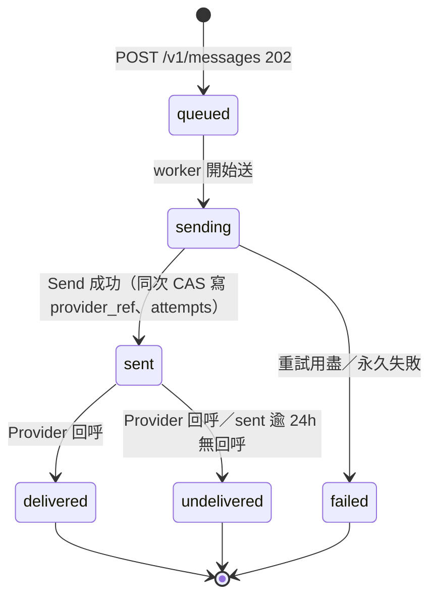
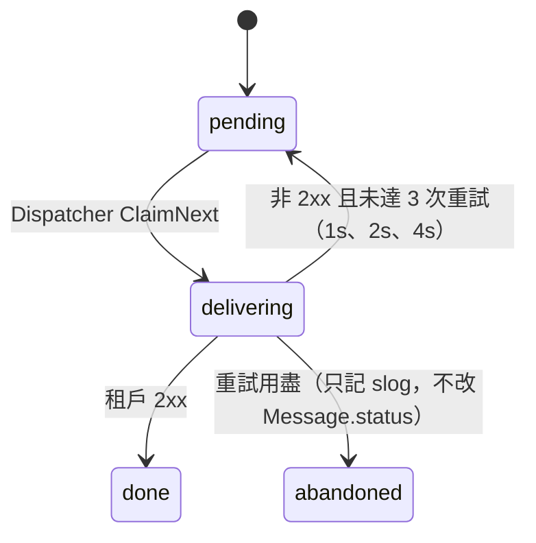

# 訊息狀態機

合法轉移只定義在 `store` 一張表（AD-5），以 compare-and-set 執行；表外轉移回 `store.ErrIllegalTransition`、狀態不變。`failed` 與 `undelivered` 須在同一次 CAS 帶非空 `failure_reason`。

| 轉移 | 觸發 | 通知租戶 |
| --- | --- | --- |
| `queued→sending` | worker 領取 | 否 |
| `sending→sent` | `Send` 成功 | 是 |
| `sending→failed` | 暫時失敗重試 3 次仍失敗（`attempts`=4，原因「重試用盡」）或永久失敗（原因「永久失敗」） | 是 |
| `sent→delivered` | 回呼 `delivered` | 是 |
| `sent→undelivered` | 回呼 `undelivered`，或 24h 無回呼（原因「回呼逾時」） | 是 |

- 通知於轉移成功的同一鎖／交易內寫入 outbox，`(message_id, status)` 唯一。
- 同一 `message_id` 的通知嚴格依產生順序送出。
- 對終態或重複回呼：視為已處理，回 200，狀態不變。
- 回呼早於 `sent` 寫入：404，由 Provider 重送。
- 終態訊息在記憶體保留 24h 後由 `PurgeExpired(now)` 移除，之後 GET 回 404。

## Webhook outbox

